# Entrega - Laboratorio SCA

## 1. Identificación del proyecto

Esta sección identifica el repositorio, las ramas utilizadas y el Pull Request donde se integraron las correcciones de seguridad.

- Repositorio: [MasterJD/Laboratorio-SCA_17001625](https://github.com/MasterJD/Laboratorio-SCA_17001625)
- Rama principal: `main`
- Rama de remediación: `fix/sca-remediation`
- Pull Request de remediación: [PR #1](https://github.com/MasterJD/Laboratorio-SCA_17001625/pull/1)
- Estado del PR: fusionado en `main`
- Commit de remediación: `c94cb003a855d42f1dafdf30da179302dde8affd`

## 2. Resultado final

El análisis final confirma que la aplicación compila correctamente, que las dependencias remediadas no presentan vulnerabilidades detectadas por Dependency-Check y que los resultados se publican automáticamente en GitHub.

- Compilación Maven: exitosa (`BUILD SUCCESS`).
- Dependency-Check local: 0 dependencias vulnerables y 0 vulnerabilidades.
- Workflow de GitHub Actions: exitoso.
- SBOM CycloneDX: generado correctamente.
- SARIF: publicado en GitHub Code Scanning.
- Reportes del pipeline: publicados como artefacto `dependency-check-reports`.
- SBOM del pipeline: publicado como artefacto `cyclonedx-sbom`.
- Secretos: la clave NVD se mantiene fuera del repositorio, mediante `.env.local` y el secreto `NVD_API_KEY` de GitHub.

## 3. Enlaces externos

Estos enlaces permiten verificar directamente la ejecución del pipeline, los jobs, los artefactos y los resultados publicados en Code Scanning.

- [Workflow del PR](https://github.com/MasterJD/Laboratorio-SCA_17001625/actions/runs/41157102979)
- [Job OWASP Dependency-Check](https://github.com/MasterJD/Laboratorio-SCA_17001625/actions/runs/41157102979/job/124406200491)
- [Job SBOM CycloneDX](https://github.com/MasterJD/Laboratorio-SCA_17001625/actions/runs/41157102979/job/124406200325)
- [Code Scanning del repositorio](https://github.com/MasterJD/Laboratorio-SCA_17001625/security/code-scanning)
- [Actions del repositorio](https://github.com/MasterJD/Laboratorio-SCA_17001625/actions)

## 4. Evidencias visuales

Las siguientes capturas documentan las actividades solicitadas: análisis local, ejecución automatizada, generación del SBOM, revisión en Dependency-Track e importación en DefectDojo.

### Dependency-Check local

Se ejecutó OWASP Dependency-Check localmente utilizando la base de datos NVD cacheada. Después de actualizar las dependencias, el reporte final indicó cero dependencias vulnerables y cero vulnerabilidades.

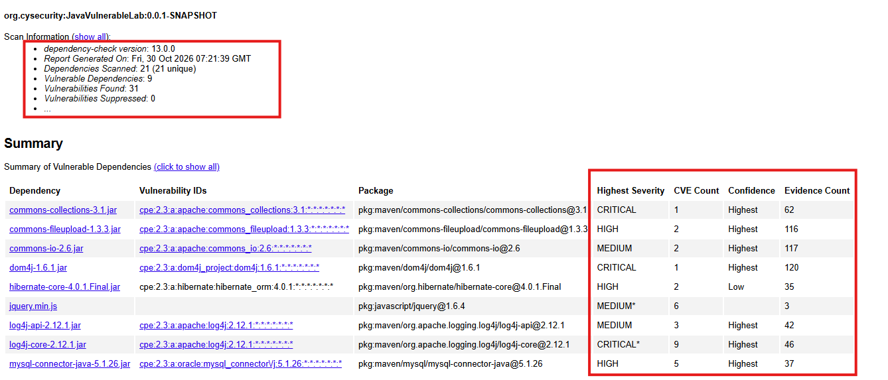

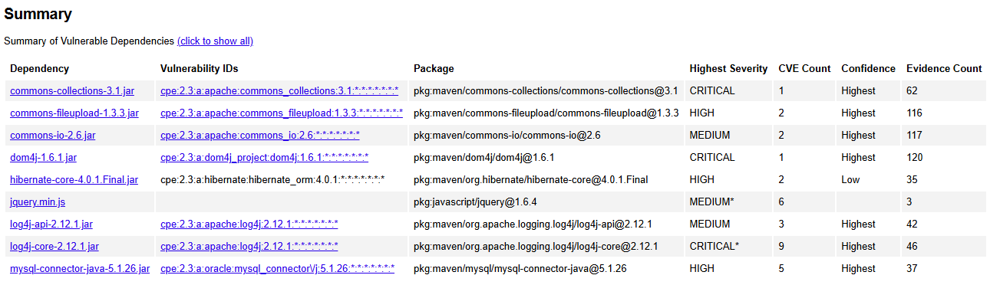

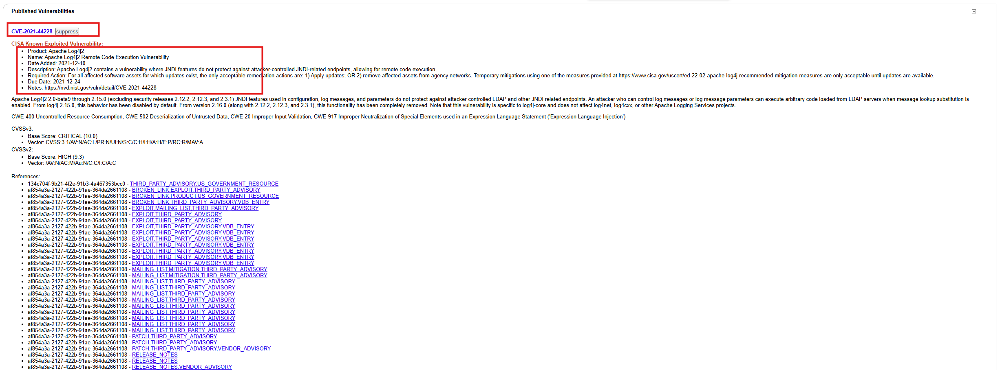

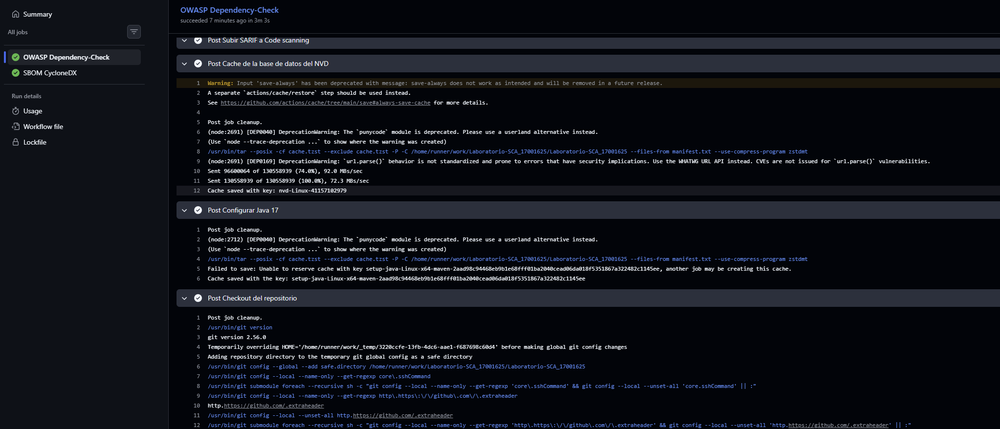

### GitHub Actions y Pull Request

El workflow automatiza el análisis en cada cambio relevante, genera los reportes y publica el SARIF. El Pull Request fue revisado y fusionado en `main`.

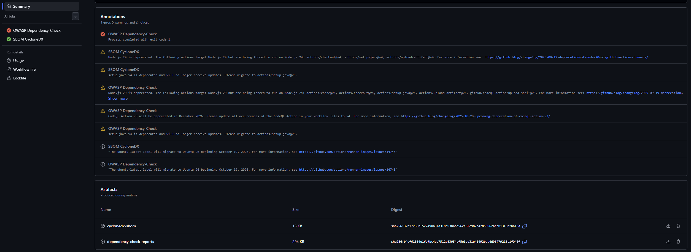

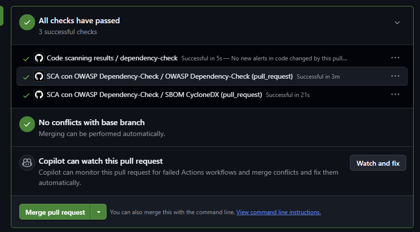

### Dependency-Track

El SBOM CycloneDX se importó en Dependency-Track para visualizar los componentes, la auditoría de vulnerabilidades y las relaciones entre dependencias.

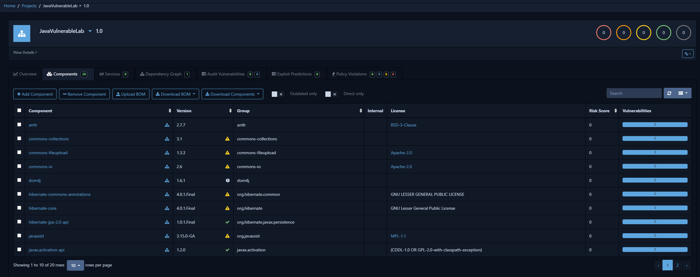

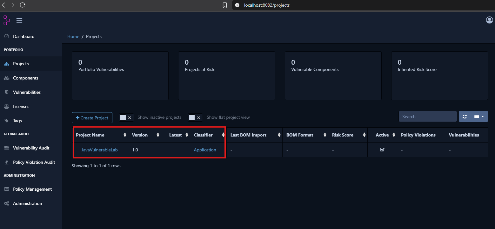

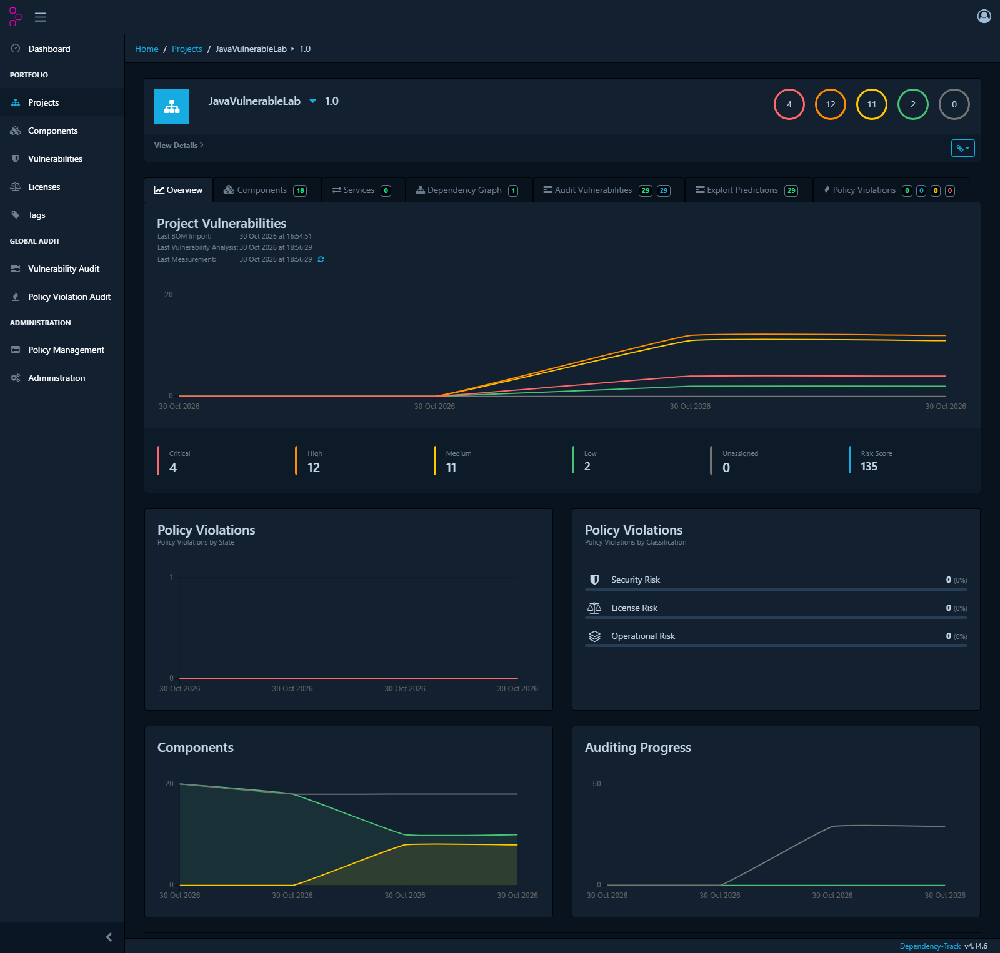

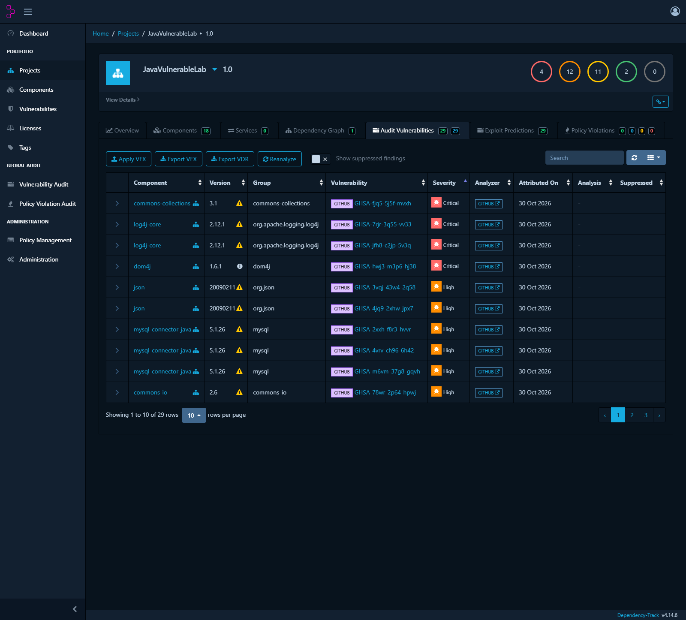

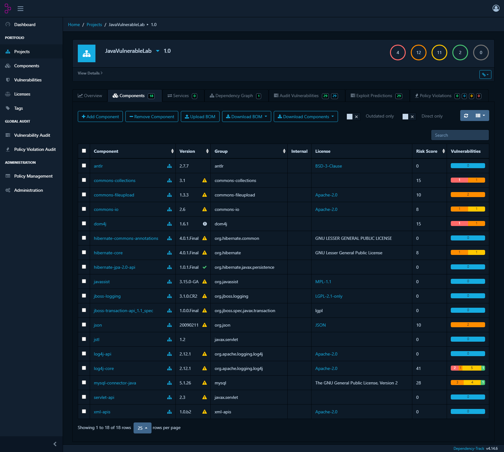

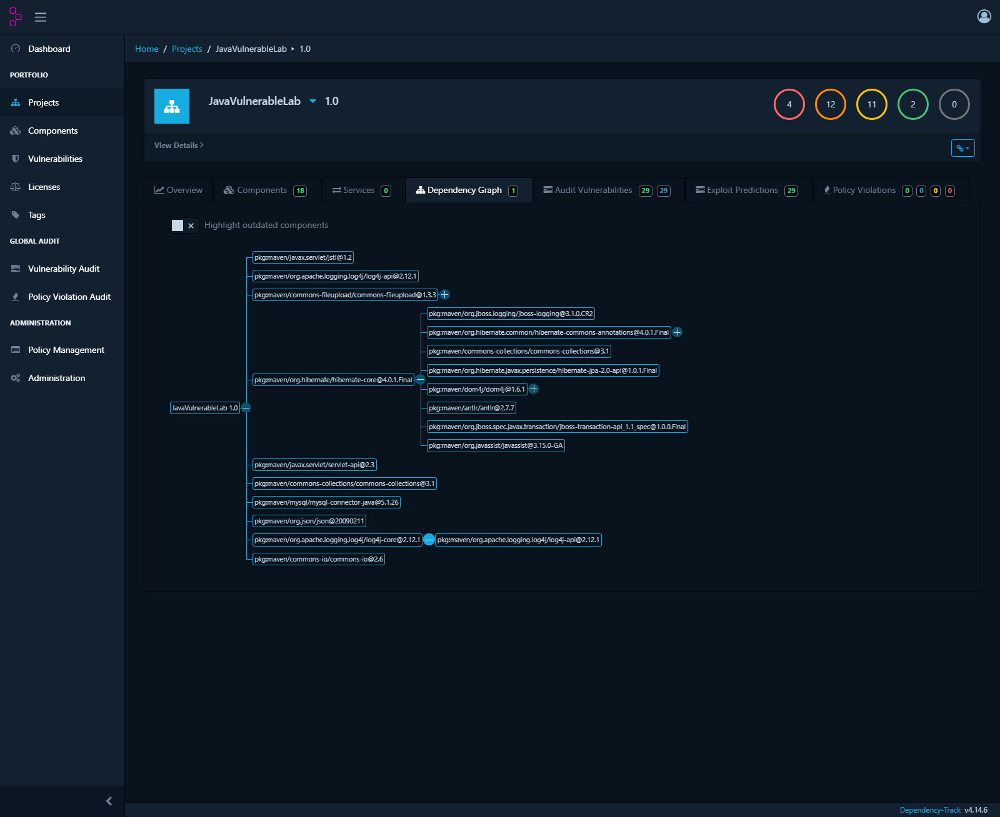

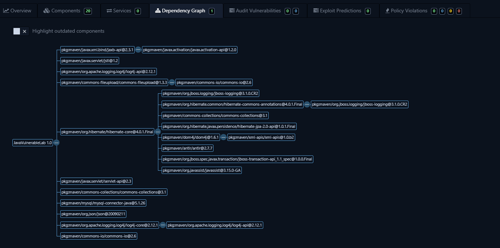

### DefectDojo

El reporte XML de Dependency-Check se importó en DefectDojo como evidencia de integración con una plataforma de gestión de vulnerabilidades.

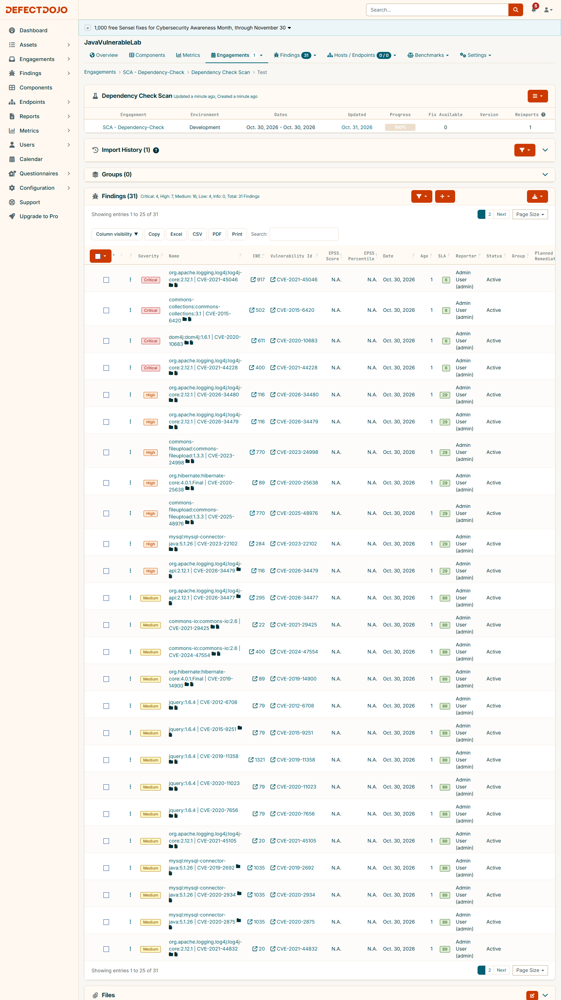

## 5. Reportes y artefactos

Esta sección reúne los archivos técnicos generados durante el análisis. Se conservan en formatos interoperables para facilitar su revisión manual y su integración con otras herramientas.

### Documento final

- [PDF final de entrega](ENTREGA.pdf)

El PDF contiene la memoria técnica resumida y las capturas embebidas de Dependency-Check, GitHub Actions, Dependency-Track y DefectDojo.

### SBOM

- [SBOM remediado CycloneDX](evidence/remediated-bom.json)
- El SBOM contiene 27 componentes y corresponde a la versión remediada del proyecto.

El SBOM representa el inventario de componentes de la aplicación y sirve como entrada para Dependency-Track.

### Reportes remotos del pipeline

- [Reporte HTML](evidence/remote-pipeline-dependency-check-reports/dependency-check-report.html)
- [Reporte JSON](evidence/remote-pipeline-dependency-check-reports/dependency-check-report.json)
- [Reporte XML](evidence/remote-pipeline-dependency-check-reports/dependency-check-report.xml)
- [Reporte SARIF](evidence/remote-pipeline-dependency-check-reports/dependency-check-report.sarif)

Estos archivos corresponden al artefacto `dependency-check-reports` descargado desde GitHub Actions.

- HTML: lectura humana del resumen y detalle de vulnerabilidades.
- JSON: información estructurada para procesamiento automatizado.
- XML: formato utilizado para integraciones como DefectDojo.
- SARIF: formato utilizado por GitHub Code Scanning.

## 6. Archivos principales de implementación

Estos archivos contienen la configuración reproducible del análisis, la generación del SBOM, las dependencias de la aplicación y las reglas para evitar publicar secretos o datos locales.

- [Workflow SCA](.github/workflows/sca-dependency-check.yml)
- [Dependencias Maven](pom.xml)
- [Reglas de exclusión](.gitignore)
- [Script de Dependency-Check](scripts/run-dependency-check.ps1)
- [Script de generación del SBOM](scripts/generate-sbom.ps1)
- [Variables de ejemplo](.env.example)
- [Documentación general](README.md)

## 7. Remediaciones aplicadas

Se actualizaron dependencias con vulnerabilidades conocidas y se eliminó información sensible simulada detectada durante la revisión del repositorio. La compilación posterior confirmó que la aplicación continúa construyéndose correctamente.

- MySQL Connector/J actualizado a `8.4.0`.
- `protobuf-java` actualizado a `3.25.5`.
- JSON actualizado a `20231013`.
- Hibernate actualizado a `5.6.15.Final`.
- dom4j actualizado a `2.1.4`.
- Log4j actualizado a `2.26.1`.
- Commons Collections actualizado a `3.2.2`.
- Commons FileUpload actualizado a `1.6.0`.
- Commons IO actualizado a `2.16.1`.
- jQuery actualizado a `3.7.1`.
- Secretos simulados retirados del código fuente.

## 8. Archivos que no deben publicarse

Estas exclusiones protegen secretos, datos persistentes de servicios locales, archivos generados y el PDF original de instrucciones. Las evidencias seleccionadas sí se incluyen de forma explícita en `evidence/`.

Los siguientes archivos se mantienen fuera del control de versiones por contener datos locales, secretos o resultados temporales:

- `.env.local`
- `target/`
- `reports/`
- `infra/**/data/`
- `Tarea_SCA_DependencyCheck.pdf`
- La copia local `javavulnerablelab-sca/`

## 9. Estado de la entrega académica

La implementación técnica, el PR, el pipeline, el SBOM, las evidencias, este índice y el [PDF final](ENTREGA.pdf) están preparados para la entrega académica.
